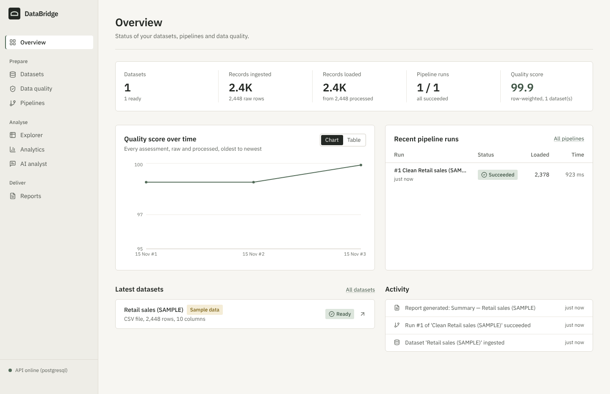
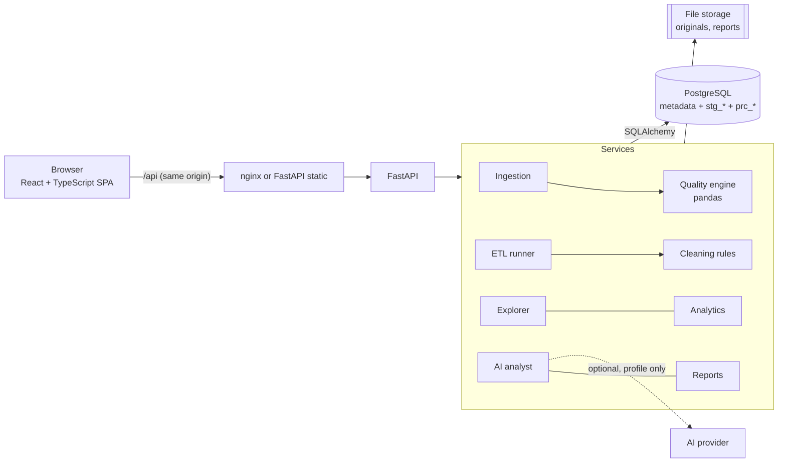
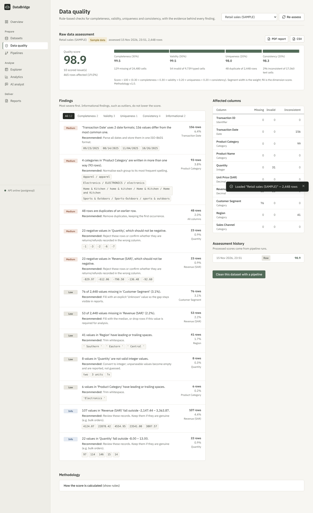
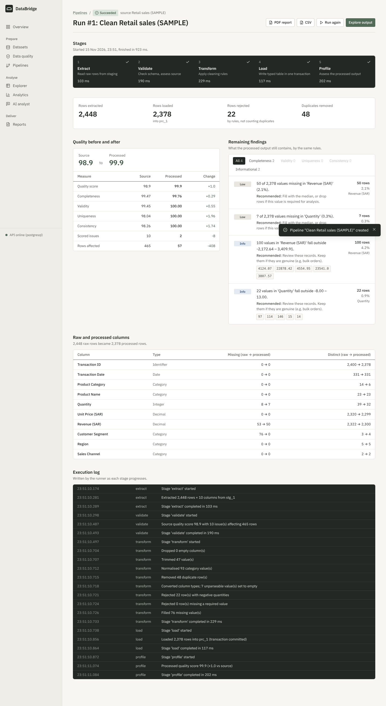
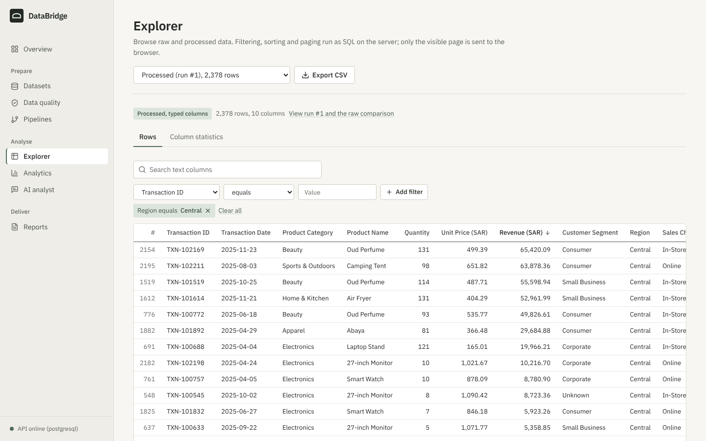
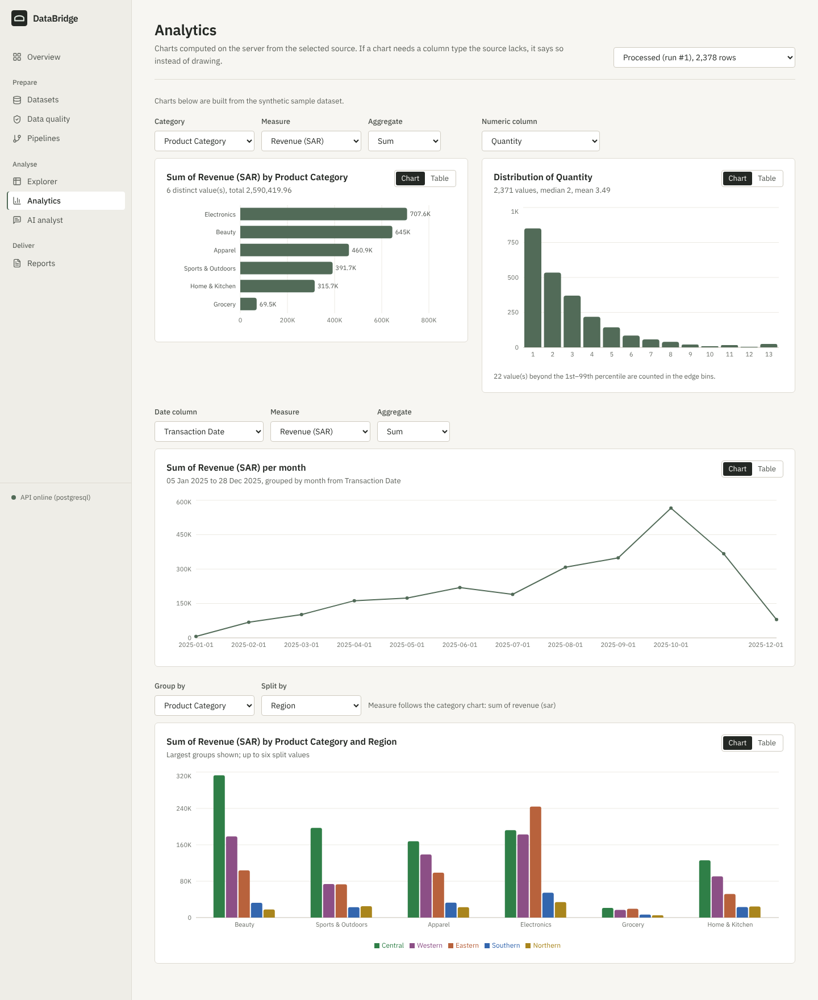
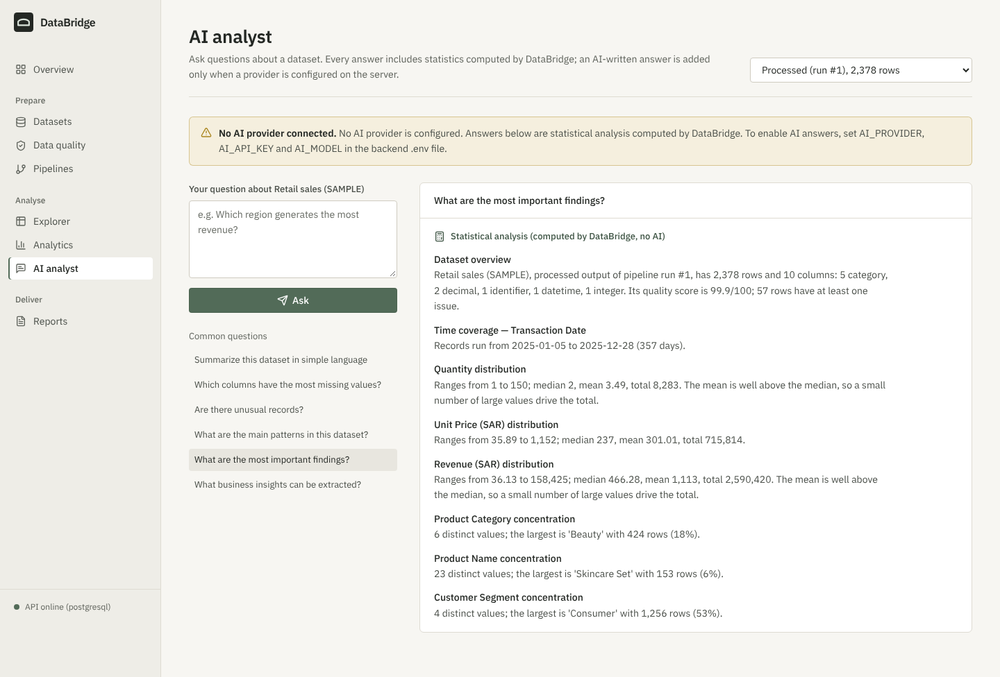
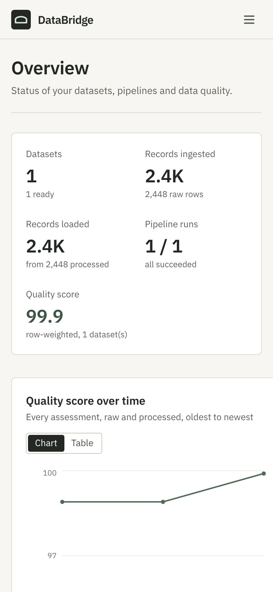

# DataBridge

**Turn messy business spreadsheets into clean, queryable data, and show exactly what changed.**

DataBridge is a data engineering and business intelligence application. Upload a CSV or Excel file and it
profiles the columns, finds quality problems with documented rules, cleans and loads the data into PostgreSQL
through a logged five-stage ETL pipeline, and lets you explore, chart, question and report on the result.



> **Status:** runs locally (Windows, macOS, Linux; Docker optional). Not yet deployed. An always-on hosting
> plan is in [docs/DEPLOYMENT.md](docs/DEPLOYMENT.md).

---

## The business problem

Teams export data from point-of-sale systems, CRMs and other people's spreadsheets. The files arrive with the
same category spelled four ways, duplicated transactions, dates in two formats, blank customer segments and
negative quantities. Reports built on them are quietly wrong, and the cleaning is done by hand, differently
each time, with no record of what changed.

## The solution

| Step | What DataBridge does |
|---|---|
| Ingest | Validates extension *and* content, enforces size limits, detects encoding and delimiter, keeps the original file untouched, and stages the raw rows in the database |
| Profile | Infers each column's type (integer, decimal, date, boolean, category, identifier, text) from the values |
| Assess | Runs 10 documented checks and computes a reproducible 0–100 quality score with the evidence behind it |
| Clean & load | Applies ordered cleaning rules and loads a typed table inside a transaction, logging every stage and every change |
| Compare | Shows quality before and after, column by column |
| Analyse | SQL-backed explorer, charts built from real columns, and an AI analyst with a statistical fallback |
| Report | PDF and CSV reports generated from stored results |

## Features

* **Datasets:** drag-and-drop upload with progress; CSV (UTF-8, Windows-1252; comma, semicolon, tab, pipe) and
  XLSX; preview, column profile, file metadata and SHA-256; rename, download the original, delete with
  confirmation; failed ingestions are kept with a clear reason.
* **Data quality:** missing values, empty columns, duplicate records and identifiers, invalid types,
  unexpected negatives, inconsistent categories, stray whitespace, mixed date formats, and outliers
  (informational). Each finding has a severity, affected rows, examples and a recommended action.
  The score methodology is in [docs/DATA_QUALITY.md](docs/DATA_QUALITY.md).
* **Pipelines:** configurable rules (trim, normalise categories, de-duplicate, convert types, reject negatives,
  required columns, missing-value strategy, type overrides). Runs show a live stage track, per-stage timings,
  row accounting, an execution log and failure handling with rollback.
* **Explorer:** raw or processed sources; server-side pagination, search, typed filters and sorting; column
  statistics; raw-versus-processed comparison; streaming CSV export with formula-injection protection.
* **Analytics:** category breakdowns, distributions, time trends and two-way comparisons, each aggregated on
  the server. If a source lacks a suitable column, the chart says so instead of drawing placeholder data.
  Every chart has a table view.
* **AI analyst:** ask questions in plain language. A statistical answer is always computed. An AI answer
  (Anthropic or OpenAI, configured on the server) is added only when a key is set; it is clearly labelled, and
  the data shared with the provider is shown.
* **Reports:** dataset summary, data quality and pipeline run reports, in PDF and CSV.
* **Overview:** dataset, record, run and quality metrics computed from application data, plus a quality trend,
  recent runs and activity. New users get a useful empty state.

## Architecture



Details: [docs/ARCHITECTURE.md](docs/ARCHITECTURE.md) · [docs/DATABASE.md](docs/DATABASE.md) ·
[docs/API.md](docs/API.md) · [docs/DESIGN_SYSTEM.md](docs/DESIGN_SYSTEM.md)

## Data processing workflow

```
Upload ─► validate file ─► parse ─► profile columns ─► stage raw rows (stg_<id>) ─► raw quality assessment
                                                                                         │
            ┌──────────────────────────── pipeline run ◄──────────────────────────────────┘
            ▼
 extract ─► validate ─► transform (rules) ─► load typed table (prc_<run>, one transaction) ─► profile output
            │                                                                                     │
            └──── logs, timings, row counts, before/after quality ◄───────────────────────────────┘
                                                   │
                         Explorer · Analytics · AI analyst · Reports
```

## Technology

| Layer | Stack |
|---|---|
| Frontend | React 18, TypeScript (strict), Vite, Tailwind CSS, TanStack Query, React Router, Recharts, Zod, Lucide icons, IBM Plex Sans (self-hosted) |
| Backend | Python 3.11–3.13, FastAPI, Pydantic v2, SQLAlchemy 2, Alembic, pandas, openpyxl, ReportLab, httpx |
| Database | PostgreSQL 16 (primary), SQLite (zero-setup local fallback) |
| Infrastructure | Docker, Docker Compose, nginx, structured JSON logging, health and readiness endpoints |
| Testing | pytest (unit + API integration, on both databases), Vitest + Testing Library, Playwright end-to-end |

## Database design (overview)

Ten metadata tables, including `datasets`, `dataset_columns`, `pipelines`, `pipeline_runs`,
`pipeline_run_logs`, `processed_datasets`, `quality_assessments`, `quality_issues` and `reports`, managed by
Alembic with check constraints, cascades and indexes. Row data lives in generated tables: `stg_<dataset>` holds
raw text and `prc_<run>` holds typed columns. See [docs/DATABASE.md](docs/DATABASE.md).

## Screenshots

| | |
|---|---|
|  Data quality findings and the weighted score |  Pipeline run: stages, before/after, log |
|  Explorer with filter and sort |  Analytics from processed data |
|  AI analyst (statistical mode) |  Responsive layout |

All screenshots show the **synthetic sample dataset**.

## Installation (Windows)

Prerequisites: Python 3.11–3.13 and Node.js 20/22. Full guide: [docs/SETUP_WINDOWS.md](docs/SETUP_WINDOWS.md).

```powershell
cd databridge
powershell -ExecutionPolicy Bypass -File scripts\setup.ps1             # one time
powershell -ExecutionPolicy Bypass -File scripts\dev.ps1               # app on http://localhost:5173
# or, production-like on one port:
powershell -ExecutionPolicy Bypass -File scripts\start-production.ps1  # http://127.0.0.1:8000
```

With Docker and PostgreSQL:

```powershell
Copy-Item .env.example .env    # then set POSTGRES_PASSWORD
docker compose up --build      # http://localhost:8080
```

## Testing

```powershell
powershell -ExecutionPolicy Bypass -File scripts\test.ps1
```

Latest results: **71 backend tests passing on SQLite and on PostgreSQL 16** (including 19 for the public demo
mode), 10 frontend tests, 0 TypeScript errors, the full demonstration workflow passing in a headless browser
with no console errors, and a two-visitor demo-mode browser test passing 27 of 27 checks. Details,
the bugs the tests caught, and benchmarks are in [docs/TESTING.md](docs/TESTING.md).

## Demonstration walkthrough (sample data)

The bundled `sample_data/retail_sales_sample.csv` is **synthetic** (`scripts/generate_sample_data.py`, fixed
seed): 2,448 retail transactions with deliberately injected problems.

1. **Upload:** Overview → *Load sample dataset*.
2. **Inspect:** 10 columns typed as identifier, date, categories, integer and decimals; the raw preview still
   shows `ELECTRONICS`, `03/15/2025`, `two`.
3. **Assess:** score **98.9**, with **465 rows (19%)** affected. Findings include 156 dates in a second format,
   93 category variants, 48 duplicate rows, 23 negative quantities, 76 missing customer segments and 8
   non-numeric quantities.
4. **Clean and run:** create a pipeline, mark Transaction ID and Transaction Date as required, *Save and run*.
5. **Result:** 2,378 rows loaded and 22 rejected; 48 duplicates removed; 93 values normalised. The score rises
   to **99.9** and rows affected fall to 57, mostly the 50 missing revenue values that are deliberately left
   empty instead of guessed.
6. **Explore:** filter Region = Central and sort by revenue.
7. **Visualise:** revenue by category, monthly trend, category × region.
8. **Report:** download the pipeline run PDF.

## Public demo mode

With `DEMO_MODE=true` DataBridge can be opened by anyone without an account: the synthetic sample, a pipeline
run and a report are ready on the first visit and are read-only; each browser's uploads are private to it
(anonymous cookie) and deleted after 24 hours; uploads are limited to 10 MB and 50,000 rows on the server;
requests are rate-limited. Try it locally with `scripts\demo.ps1`. Details and limitations:
[docs/DEMO_MODE.md](docs/DEMO_MODE.md).

## Configuration

All settings are environment variables (see `backend/.env.example` and `.env.example`). The main ones:
`DATABASE_URL`, `MAX_UPLOAD_MB`, `MAX_ROWS`, `MAX_COLUMNS`, `CORS_ORIGINS`, `WEB_CONCURRENCY`, and optionally
`AI_PROVIDER`, `AI_API_KEY`, `AI_MODEL`, and `DEMO_MODE` with its limits. No secrets are committed or have defaults.

## Security measures

Extension and content validation, streamed size limits, generated storage names with path containment,
validated SQL identifiers with bound parameters, formula-injection-safe CSV export, server-side-only AI keys,
security headers and CSP (nginx), restricted CORS, and consistent error responses that never include stack
traces. In demo mode: per-visitor data isolation by anonymous cookie, read-only shared data, per-IP rate
limits and per-visitor quotas. **Not implemented:** authentication (demo isolation is not a login), encryption
at rest. DataBridge does not claim any
compliance certification.

## Future improvements

Job queue for long runs, authentication and workspaces, user-defined validation rules, scheduled pipelines,
database and API sources, object storage, CI with GitHub Actions. The full roadmap is in
[docs/PORTFOLIO.md](docs/PORTFOLIO.md).

## Project presentation

For recruiters and interviews: [docs/PORTFOLIO.md](docs/PORTFOLIO.md) covers purpose, challenges, solutions,
measured results and a two-minute demo script.
