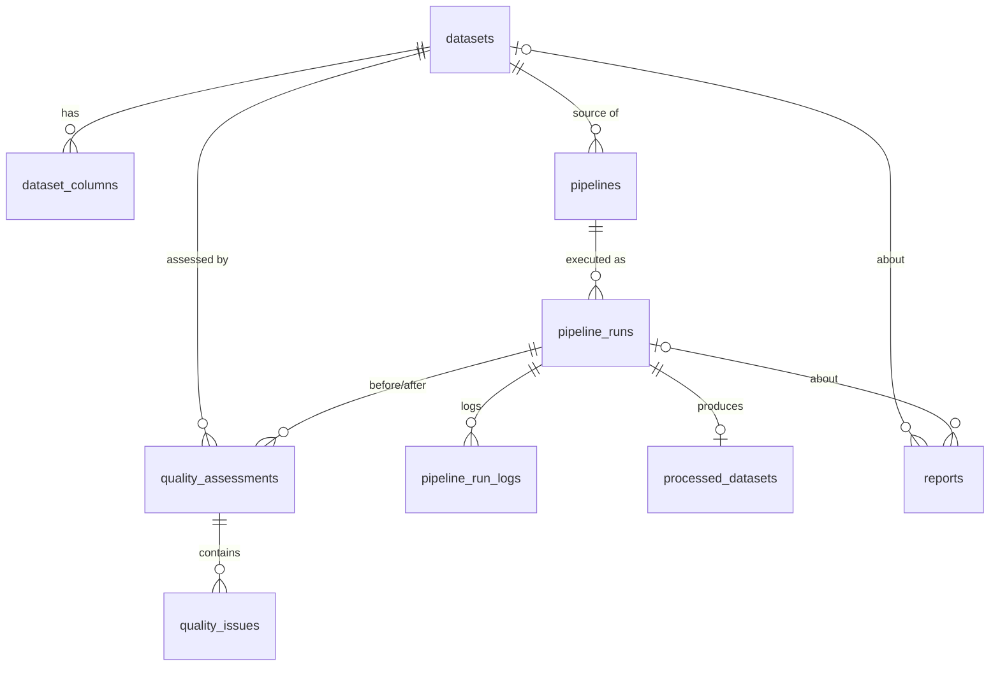

# Database design

PostgreSQL 16 is the primary database (Docker Compose, production); SQLite is the zero-setup fallback for local
development. The schema is created only by **Alembic migrations** (`backend/alembic/versions`), and the test
suite builds its database by running those migrations against both engines.

## Two kinds of tables

1. **Metadata tables**, defined as SQLAlchemy models (`backend/app/models/__init__.py`) and managed by Alembic.
2. **Row tables**, generated at runtime:
   * `stg_<dataset_id>`: raw staged rows, every column `TEXT`, exactly as parsed from the file.
   * `prc_<run_id>`: processed output of a successful run, with typed columns (`BIGINT`, `DOUBLE PRECISION`,
     `BOOLEAN`, `TIMESTAMP`, `TEXT`) and indexes on category, date and identifier columns.

   Both have `_row_id INTEGER PRIMARY KEY`, giving stable pagination and a link back to the source row number.
   Alembic's `include_object` hook excludes them so autogenerate never tries to drop them.

## Entity relationships



| Table | Purpose | Key constraints and indexes |
|---|---|---|
| `datasets` | One uploaded file: name, original/stored filename, format, size, SHA-256, encoding/delimiter or sheet, row/column counts, status, error, staging table, sample flag | `status IN (processing, ready, failed)`, `file_format IN (csv, xlsx)`, unique `stored_filename`, indexes on `created_at`, `sha256` |
| `dataset_columns` | Column profile: original name, safe key, inferred type, null and distinct counts, sample values | FK → datasets **ON DELETE CASCADE**; unique `(dataset_id, position)` and `(dataset_id, key)` |
| `pipelines` | Name, description and the transformation config (JSON, validated by Pydantic) | FK → datasets CASCADE |
| `pipeline_runs` | Status, current stage, config snapshot, row counts, per-stage timings, error stage/message, timestamps, duration | `status IN (pending, running, succeeded, failed)`, index `(status, created_at)` |
| `pipeline_run_logs` | Ordered log lines per run: stage, level, message, structured context | `level IN (debug, info, warning, error)`, FK CASCADE |
| `processed_datasets` | Metadata of a run's output table: table name, row/column counts, typed column list | unique `run_id`, unique `table_name` |
| `quality_assessments` | Score, four dimension scores, counts behind them, issue and affected-row totals, methodology version, stage (raw or processed), optional run | `score BETWEEN 0 AND 100`, `stage IN (raw, processed)`, index `(dataset_id, created_at)`, index on `run_id` |
| `quality_issues` | One finding: check, dimension, severity, column, affected rows and ratio, message, recommendation, examples | `severity IN (critical … info)`, FK CASCADE |
| `reports` | Generated report file metadata: kind, format, title, size | FK → datasets / runs **ON DELETE SET NULL**, so reports outlive their sources |
| `app_settings` | Key/value application settings | primary key `key` |

## Design decisions

* **Config snapshot on each run.** Editing a pipeline never changes what an earlier run did; the run stores the
  config it actually used.
* **Cascades versus history.** Deleting a dataset removes everything derived from it (columns, pipelines, runs,
  assessments, and the generated `stg_`/`prc_` tables, dropped by the service layer), but keeps generated
  reports, which are historical documents.
* **JSON columns** (`config`, `details`, `examples`, `context`) hold variable-shaped data that is always read as
  a whole and never filtered on. Everything filtered or joined on is a real column.
* **Why not one generic rows table with JSON per row?** Typed tables let PostgreSQL filter, sort and aggregate
  with indexes, and let processed data be queried with plain SQL by any BI tool.
* **Identifier safety.** Table names are generated from integer IDs. Column keys are derived from source
  headers (ASCII snake_case, deduplicated, reserved words suffixed) and must match `^[a-z][a-z0-9_]{0,62}$`.
  The Explorer also checks every client-supplied column key against the source's stored metadata, and all
  values are bound parameters.
* **Atomic ingestion.** Column metadata and the staging table are written in one transaction on one connection;
  a failure leaves neither behind.
* **Bulk loading.** On PostgreSQL, processed and staged rows are written with `COPY … FROM STDIN` inside the
  same transaction; SQLite uses batched `INSERT`s of 5,000 rows.
* **Connection pool.** `pool_size=5`, `max_overflow=5`, `pool_pre_ping=True` and `pool_recycle=1800`, so
  connections are checked after idle periods instead of failing on the first request.

## Migrations

```powershell
cd backend
.venv\Scripts\python -m alembic upgrade head                      # apply
.venv\Scripts\python -m alembic revision --autogenerate -m "..."  # after changing models
.venv\Scripts\python -m alembic check                             # models and migrations agree
```

Containers run `alembic upgrade head` before starting the server.
